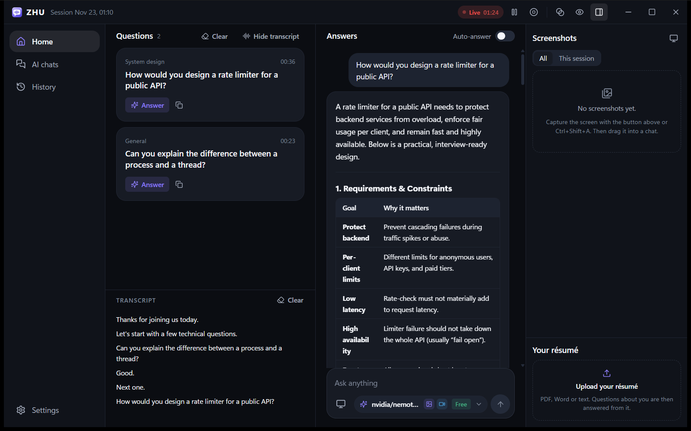
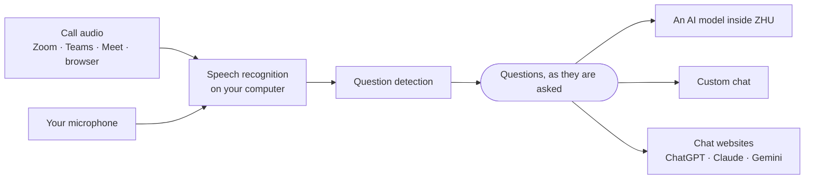
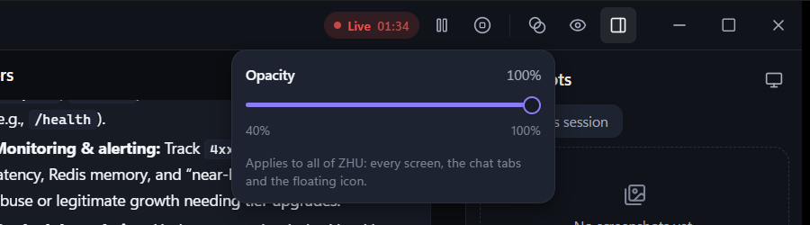

<div align="center">


# ZHU

**Hear every question. Have an answer ready.**

ZHU is a Windows desktop app that listens to a conversation, writes down each question as it is asked,<br/>
and helps you answer it. Speech recognition runs on your own computer.


[What it does](#what-zhu-does) · [Install](#install) · [Using ZHU](#using-zhu) · [Run from source](#run-from-source) · [Privacy](#privacy) · [Documentation](#documentation)

<br/>



<sub>ZHU while listening: the recording time and controls in the title bar, questions picked out of the conversation, the live transcript, and an answer.</sub>

</div>

---

## What ZHU does

In an interview or a meeting, questions come quickly and are easy to lose. ZHU keeps up with them for you.

It listens to the call and to your microphone, turns the speech into text **on your computer**, and picks out the questions. Each one appears on screen, written out clearly, a moment after it is asked. From there, one click gets an answer from the AI model you chose, or ZHU can answer every question by itself.



Audio is never uploaded and never saved. A question leaves your computer only when it is sent to the AI model or the website you picked.

## Highlights

| | |
|---|---|
| **Live questions** | Every question in the conversation is collected, newest first, while the full transcript runs underneath. |
| **Listening, one click away** | Start, pause and stop from the title bar, on every screen, with the recording time always in view. |
| **Answers, three ways** | An AI model connected inside ZHU, ZHU's own Custom chat, or the chat websites you already use (ChatGPT, Claude, Gemini and others) opened as tabs. |
| **Free to start** | Two services answer without a key or an account. Google Gemini, Groq and OpenRouter have free tiers. Paid providers and local models (Ollama, LM Studio) work too. |
| **Auto-answer** | Switch it on and each detected question is answered without a click. |
| **Screenshots** | Capture the screen with one shortcut and send the picture with your question. ZHU keeps itself out of its own screenshots. |
| **Knows what a model can read** | The model list marks each model: images, documents, audio, video, or text only. A screenshot is never sent to a model that cannot read it. |
| **Your résumé** | Upload it once and questions about you are answered from it, in your voice. |
| **Your layout** | Drag the lines between questions, answers and transcript to size them your way. ZHU remembers it. |
| **Opacity** | Make ZHU see-through, from 40% to 100%: the whole window, chat tabs included. |
| **Hide mode** | One button takes ZHU out of the taskbar, Alt+Tab and screen captures, keeps it on top of your screen, and makes it 80% see-through. |
| **One process** | The engine runs inside ZHU itself: one entry in Task Manager. If it ever stops, the window stays and **Restart engine** brings it back. |
| **History** | Every session with its questions and answers, to reopen, export or delete. |

## Install

**Requirements**

| | |
|---|---|
| System | Windows 10 (21H2 or later) or Windows 11, 64-bit |
| Memory | 8 GB minimum, 16 GB recommended |
| Graphics | Optional. An NVIDIA card (driver 550 or later) makes transcription faster; without one ZHU uses the processor |

**Steps**

1. Download `ZHU-Setup.exe` from the [Releases](../../releases) page (about 880 MB). Every version is built there automatically. No release yet? [Build it](#build-the-installer) with one command.
2. Run it. It installs for your user account and needs no administrator rights. Nothing else has to be installed: no Python, no Node, no CUDA toolkit.
3. Start ZHU from the Start menu. The first time, it asks you to download a speech model (once; after that it works offline). ZHU looks at your hardware and recommends one.

> [!NOTE]
> Builds from this repository are not code-signed yet, so Windows SmartScreen may show "Windows protected your PC". Choose **More info**, then **Run anyway**.

## Using ZHU

ZHU has four screens: **Home**, **AI chats**, **History** and **Settings**.

### 1. Choose how you want answers

Either way works, and you can use both.

* **An AI model inside ZHU.** Open **Settings → Answers → Manage models**. For a free start, press **Get a free key** next to Google Gemini, Groq or OpenRouter, paste the key and press **Connect**. ZHU checks the key and picks a model.
* **No key at all.** Open **AI chats → + → Custom chat** and press **Start without a key**. Two free public services answer right away. Their providers may log what you send, so keep sensitive text for a provider you have a key for.
* **The chat websites you already use.** Open **AI chats → +** and pick ChatGPT, Claude, Gemini or another site. Sign in once, as in a browser.

<p align="center">
  
</p>

### 2. Start listening

Press **Start listening** in the title bar; it is there on every screen. ZHU listens to the call (your computer's sound) and to your microphone. While it listens, the title bar shows **Live** with the time, and **Pause** and **Stop** next to it; the tray icon says whether ZHU is recording too. The **+** next to Start listening opens a fresh session.

<p align="center">
  
</p>

### 3. Read the questions, get the answers

* **Questions** (left) lists every question that is asked. **Answer** asks your AI model, **Copy** copies the question, and the **⋯** menu corrects the wording or removes something that was not a question.
* **Answers** (right) shows the replies like a chat, with formatted text, tables, code and formulas.
* **Auto-answer** (top of Answers) answers each question as soon as it is detected.
* The box at the bottom (**Ask anything**) takes your own question. The model chip inside it changes the model. The same model answers on Home and in Custom chat.
* **Make room** where you need it: drag the line between Questions and Answers, or the line above the transcript. Double-click a line to go back to the original sizes.

### 4. Add what is on your screen

Press **Ctrl+Shift+A**, or the screen button in the ask box, to capture the whole screen. The picture is attached to your next question, and it also lands in the **Screenshots** panel on the right, from where you can drag it into any message box.

The model list shows what each model can read, so pick one with the image mark when you want to send a screenshot.

<p align="center">
  
</p>

### 5. Let it answer as you

In the panel on the right, upload **your résumé** (PDF, Word or text). While it is switched on, questions about you ("tell me about yourself", "what was your biggest project?") are answered from it. Under **Settings → Answers → How answers should sound** you can add a sentence that goes with every question, for example *"Answer briefly, the way I would say it in an interview."*

### 6. Keep it in view, or out of the way

* **Opacity:** the opacity button in the title bar makes ZHU see-through, so you can read what is behind it. It applies to everything in ZHU, the chat tabs included.
* **Hide mode:** the eye button in the title bar takes ZHU out of the taskbar, Alt+Tab and screen captures, keeps the main window on top of your other windows, and sets the opacity to 80% (change it as you like while hidden; showing ZHU again brings back your usual opacity). Minimize it and a small floating icon brings it back. Hide mode is off again every time ZHU starts.

### Keyboard shortcuts

These work from any app. Change them under **Settings → App → Edit shortcuts**.

| Shortcut | Action |
|---|---|
| `Ctrl` `Shift` `L` | Start, pause or resume listening |
| `Ctrl` `Shift` `A` | Screenshot of the whole screen |
| `Ctrl` `Shift` `C` | Copy the latest question |

The [user manual](docs/USER_MANUAL.md) covers every screen in detail.

## Run from source

**You need:** Python 3.12 or later, Node 18.20 or later, Rust (stable, MSVC), Visual Studio Build Tools 2022 with the C++ workload, and the WebView2 runtime.

```powershell
# 1. The engine (speech recognition, question detection, AI providers)
cd engine
py -3 -m venv .venv
.venv\Scripts\pip install -e ".[dev,cuda]"
.venv\Scripts\pip uninstall -y onnxruntime
.venv\Scripts\pip install --force-reinstall --no-deps onnxruntime-directml==1.24.4
.venv\Scripts\python -m pytest

# 2. The desktop app (it runs the engine inside itself, with the Python of engine\.venv)
cd ..\apps\desktop
npm install
npm test
npm run tauri dev
```

The two `onnxruntime` lines replace the processor-only build that one dependency pulls in with the DirectML build ZHU uses.

### Build the installer

From the repository root:

```powershell
powershell -ExecutionPolicy Bypass -File packaging\build.ps1
```

This runs the tests, freezes the engine, builds the app and writes `dist\ZHU-Setup.exe` with its SHA-256 checksum next to it. Useful switches: `-SkipInstall` reuses the packages already installed (quicker, and it works while the dev session is running), `-SkipTests` skips the test suites, and `-Sign` code-signs. With `-SkipInstall` a build takes about four minutes on the development laptop, including every test and a check that the app can run the freshly built engine.

> [!TIP]
> Close a running `npm run tauri dev` session first. The script reinstalls dependencies, and Windows refuses to replace files that the running app has open.

### Publish a version

Push to `main` and GitHub does the rest: it works out the next version from your commit messages, builds the installer, and publishes it on the [Releases](../../releases) page.

| Your commit says | Version goes |
|---|---|
| `feat!: …`, or `BREAKING CHANGE: …` in the message | 1.4.2 → **2**.0.0 |
| `feat: …`, or starts with Add, Implement, New, Support… | 1.4.2 → 1.**5**.0 |
| anything else (fixes, clean-ups) | 1.4.2 → 1.4.**3** |

`packaging\version.ps1` tells you what the next version would be before you push. A push that changes only documentation is skipped. Details: [Installation, Releasing](docs/INSTALLATION.md#releasing-the-installer-is-built-on-github).

## Privacy

* **Speech stays local.** Transcription and question detection run on your computer. Audio is held in memory only: it is never written to disk and never uploaded.
* **You decide what is sent.** An AI model receives a question when you press **Answer** or **Send**, or automatically while Auto-answer is on. A screenshot is sent only when it is attached and you send.
* **Keys are kept by Windows.** API keys go into Windows Credential Manager, not into files or the database.
* **Your data is yours.** Sessions, screenshots and models live in `%LOCALAPPDATA%\app.zhu.desktop\data`. **Settings → Your data → Delete everything** removes them.
* **No telemetry.** ZHU reports nothing about you or your use of it.

More in [Security and privacy](docs/SECURITY_PRIVACY.md).

## Project layout

```
ZHU
├── apps/desktop          The desktop app (Tauri 2)
│   ├── src               Front end: React and TypeScript
│   └── src-tauri         Windows shell in Rust: windows, tray, shortcuts, hide mode, runs the engine in-process
├── engine/zhu_engine     The processing engine in Python, run inside the app (local server on 127.0.0.1, token-protected)
│   ├── audio · vad · stt Capture, voice detection, speech recognition (Whisper or NVIDIA Parakeet)
│   ├── questions         Question detection: rule-based, runs on the processor
│   └── providers         Connections to AI model providers
├── packaging             PyInstaller spec and the installer build script
└── docs                  Guides and reference
```

## Documentation

| Start here | Reference | Under the hood |
|---|---|---|
| [User manual](docs/USER_MANUAL.md) | [AI model providers](docs/PROVIDERS.md) | [Architecture](docs/ARCHITECTURE.md) |
| [Installation](docs/INSTALLATION.md) | [Custom chat](docs/CHAT.md) | [Audio pipeline](docs/AUDIO_PIPELINE.md) |
| [Troubleshooting](docs/TROUBLESHOOTING.md) | [Chat websites](docs/WEB_CHATS.md) | [Question engine](docs/QUESTION_ENGINE.md) |
| [Security and privacy](docs/SECURITY_PRIVACY.md) | [Configuration](docs/CONFIGURATION.md) | [Database](docs/DATABASE.md) · [Front end](docs/FRONTEND.md) |
| | [Benchmarks](docs/BENCHMARKS.md) | [Testing](docs/TESTING.md) |

## Responsible use

ZHU is made for mock interviews, preparation, and meetings where transcription and assistance are permitted. Before you transcribe other people, get the consent that the law and the meeting's rules require. Hide mode keeps ZHU out of a shared screen, so other participants cannot see that it is in use: telling them is up to you.

## License

[MIT](LICENSE) © 2026 KiranKK1111
